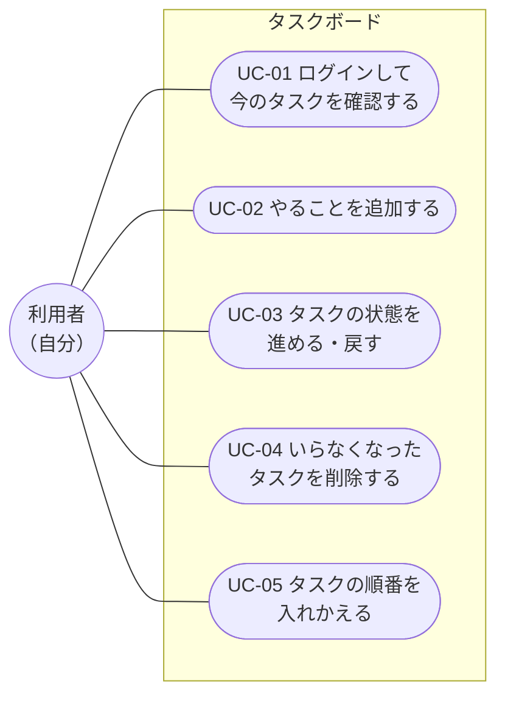
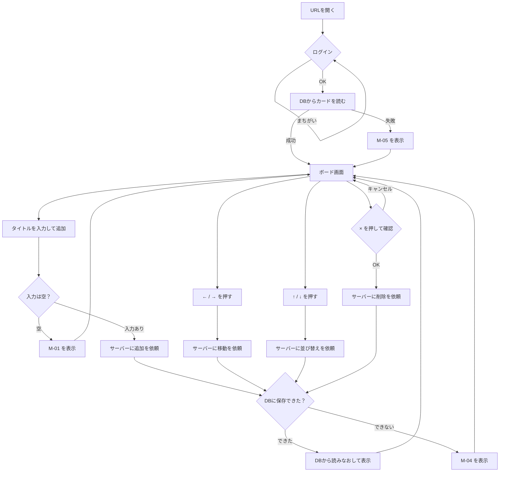
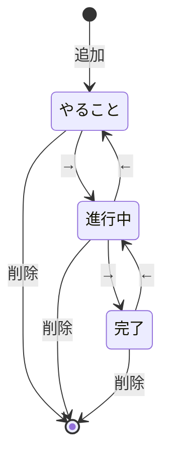

# ユースケース・操作フロー

> 機能（F-xx）は [要件定義](01_requirements.md)、メッセージ（M-xx）は [画面設計](03_screen-design.md) を参照

## ユースケース一覧
| ID | ユースケース | 関係する機能 |
|----|--------------|-------------|
| UC-01 | ログインして今のタスクを確認する | F-01, F-05, F-06, F-07 |
| UC-02 | やることを追加する | F-02, F-05 |
| UC-03 | タスクの状態を進める・戻す | F-03, F-05 |
| UC-04 | いらなくなったタスクを削除する | F-04, F-05 |
| UC-05 | タスクの順番を入れかえる | F-09, F-05 |

どのユースケースでも、通信に失敗したときは M-04 / M-05 を表示し、データは変えない（F-08）。

## ユースケース図
「だれが」「このアプリで何をするか」を1枚で表した図。
（GitHub上ではMermaidで図として表示されます）

図の読み方：
- 左の丸が **アクター**（アプリを使う人）。利用者は自分ひとりだけ（[要件定義](01_requirements.md)の「利用者と利用環境」）。
- 四角の枠が **システムの範囲**（このアプリでできること）。枠の中の楕円が **ユースケース**。
- 線は「この人がこのユースケースを行う」という意味。
- UC-02〜05 は、UC-01 でログインしてボードを開いたあとに行う（各ユースケースの「前提」を参照）。
- 「作らないもの」（ユーザー登録・共有など）は、枠の中に入れていない。

## ユースケースの詳細

**UC-01 ログインして確認する**
- 前提：なし
- 流れ：
  1. 利用者がURLを開く。
  2. ブラウザがログイン画面を出し、利用者がユーザー名とパスワードを入れる。
  3. サーバーが画面を返す。
  4. 画面がサーバーにカード一覧を依頼し、サーバーがDBから読んで返す。
  5. 画面が3列とカードを表示する。
- 別の流れ：
  - 2a. パスワードがちがう → もう一度ログイン画面が出る。
  - 4a. DBにカードが無い → 空のボードを表示する。
  - 4b. 通信に失敗した → 空のボードと M-05 を表示する。
- 終わったとき：DBに保存されている状態が表示されている。

**UC-02 やることを追加する**
- 前提：ログインしてボードが表示されている。
- 流れ：
  1. 利用者が入力欄にタイトルを入力する。
  2. 利用者が「追加」ボタンを押す（またはEnterキー）。
  3. 画面がサーバーに追加を依頼し、サーバーがDBに保存する。
  4. 画面がDBから一覧を読みなおして表示し、入力欄を空にする。
- 別の流れ：
  - 2a. 入力が空・空白だけ → M-01 を表示し、サーバーには送らない。
  - 3a. サーバーのチェックでエラー・通信失敗 → M-04 を表示し、入力欄の文字は残す。
- 終わったとき：新しいカードが「やること」列に表示され、DBに保存されている。

**UC-03 状態を進める・戻す**
- 前提：カードが1枚以上ある。
- 流れ：
  1. 利用者がカードの「→」（または「←」）を押す。
  2. 画面がサーバーに移動を依頼し、サーバーがDBの列を書きかえる。
  3. 画面がDBから一覧を読みなおして表示する。
- 別の流れ：
  - 2a. 通信失敗・カードがすでに無い → M-04 を表示する。
- 終わったとき：カードが移動先の列の一番下に表示され、DBに保存されている。

**UC-04 削除する**
- 前提：カードが1枚以上ある。
- 流れ：
  1. 利用者がカードの「×」を押す。
  2. 画面が確認ダイアログ（M-02）を出す。
  3. 利用者が「OK」を押す。
  4. 画面がサーバーに削除を依頼し、サーバーがDBから消す。
  5. 画面がDBから一覧を読みなおして表示する。
- 別の流れ：
  - 3a. 「キャンセル」を押す → 何もしない。
  - 4a. 通信失敗 → M-04 を表示する。
- 終わったとき：カードが画面とDBから消えている。

**UC-05 順番を入れかえる**
- 前提：「やること」か「進行中」に、カードが2枚以上ある。
- 流れ：
  1. 利用者がカードの「↑」（または「↓」）を押す。
  2. 画面がサーバーに並び替えを依頼し、サーバーがDBの並び順を書きかえる。
  3. 画面がDBから一覧を読みなおして表示する。
- 別の流れ：
  - 2a. 通信失敗・カードがすでに無い・すでに一番上（一番下）にある → M-04 を表示する。
- 終わったとき：カードが1つ上（下）に表示され、DBに保存されている。

## 操作フロー図
（GitHub上ではMermaidで図として表示されます）

## カードの状態の変化

