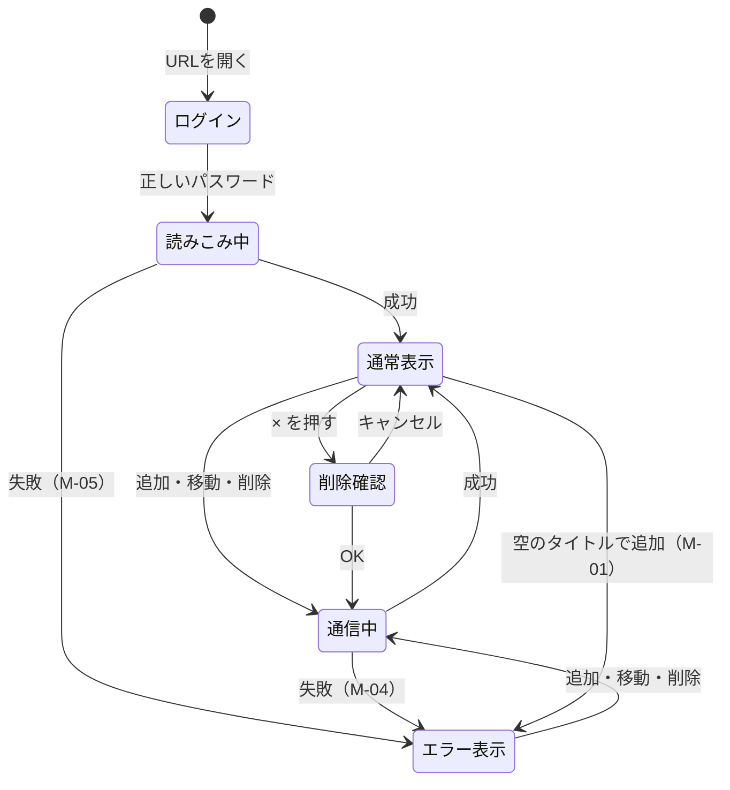

# 画面設計

> 機能（F-xx）は [要件定義](01_requirements.md)、操作の流れは [ユースケース](02_usecases.md) を参照

## 画面一覧
| ID | 画面名 | 説明 |
|----|--------|------|
| S-00 | ログイン | ブラウザ標準のダイアログ（自分では作らない） |
| S-01 | ボード画面 | このアプリの画面 |

## レイアウト（PC：幅768px以上）
```
+------------------------------------------------------------------+
| ① タスクボード                                                    |
+------------------------------------------------------------------+
| ② [ タイトルを入力（50文字まで）            ] ③[ 追加 ]           |
|    ④ タイトルを入力してください  ← 入力エラーのときだけ表示        |
|    ⑧ 保存できませんでした：…    ← 通信エラー・読みこみ中のとき表示 |
+------------------------------------------------------------------+
| ⑤ やること（2）    | ⑤ 進行中（1）      | ⑤ 完了（1）            |
| +----------------+ | +----------------+ | +----------------+     |
| | ⑥ 宿題       ×| | | ⑥ そうじ     ×| | | ⑥ 歯みがき   ×|     |
| |            [→] | | | [←]        [→] | | | [←]            |     |
| +----------------+ | +----------------+ | +----------------+     |
| +----------------+ |                    |                        |
| | ⑥ 買い物     ×| |                    |                        |
| |            [→] | |                    |                        |
| +----------------+ |                    |                        |
+------------------------------------------------------------------+
```

## レイアウト（スマホ：幅768px未満）
3列を縦にならべる（上から やること → 進行中 → 完了）。入力欄と追加ボタンは横幅いっぱいにする。

## 画面の部品
| No | 部品 | 種類 | 内容・動き |
|----|------|------|-----------|
| ① | タイトル | 見出し（h1） | 「タスクボード」と表示 |
| ② | タイトル入力欄 | テキスト入力 | プレースホルダー「タイトルを入力（50文字まで）」。最大50文字。Enterで追加 |
| ③ | 追加ボタン | ボタン | 押すとF-02を実行。通信中は押せない |
| ④ | 入力エラー | 文字 | M-01。入力が空で追加したときだけ赤字で表示。正しく追加すると消える |
| ⑤ | 列の見出し | 見出し（h2） | 列名と枚数。例「やること（2）」 |
| ⑥ | カード | 枠 | タイトル・削除ボタン（×）・移動ボタン（← / →）を持つ。列ごとに色を変える |
| ⑥-a | カードのタイトル | 文字 | 長いときは折り返して全部表示する |
| ⑥-b | 削除ボタン（×） | ボタン | 押すと確認ダイアログ（F-04）。通信中は押せない |
| ⑥-c | 移動ボタン（← / →） | ボタン | 押すととなりの列へ移動（F-03）。端の列では片方を出さない。通信中は押せない |
| ⑦ | 空の列の表示 | 文字 | カードがない列に「カードはありません」と薄い文字で表示 |
| ⑧ | 状態メッセージ | 文字 | 読みこみ中は M-03、通信エラーは M-04 / M-05 を赤字で表示。成功すると消える |

## メッセージ一覧
| ID | 表示する場面 | 文言 |
|----|-------------|------|
| M-01 | 空のタイトルで追加しようとした | タイトルを入力してください |
| M-02 | 削除ボタンを押した | 「（タイトル）」を削除しますか？ |
| M-03 | ページを開いて読みこんでいる | 読みこみ中… |
| M-04 | 追加・移動・削除に失敗した | 保存できませんでした：（サーバーからの理由） |
| M-05 | 開いたときの読みこみに失敗した | カードを読みこめませんでした：（理由） |
| M-06 | 列にカードがない | カードはありません |

## 見た目のルール
| 項目 | ルール |
|------|--------|
| 色 | 背景は明るいグレー、列は白、カードは列ごとに薄い黄・青・緑 |
| 文字 | 本文16px以上。背景との差（コントラスト）をはっきりさせる |
| ボタン | 押せる大きさを縦横 32px 以上にする（スマホで押しやすいように） |
| フォーカス | Tabキーで選んでいる部品には青い枠線を表示する |

## 画面遷移
ボード画面は1つだけで、別のページへ移動することはない。そのかわり、同じ画面の中で次の「状態」が切りかわる。



| 状態 | 画面のようす | できる操作 |
|------|-------------|-----------|
| ログイン | ブラウザのログイン画面 | ユーザー名・パスワードの入力 |
| 読みこみ中 | ボードは空で M-03 が出ている | なし |
| 通常表示 | ボードが表示されている | 追加・移動・削除 |
| 通信中 | ボタンが押せなくなっている | なし（一瞬で終わる） |
| エラー表示 | 通常表示に加えて、M-01 / M-04 / M-05 が赤字で出ている | 通常表示と同じ（もう一度ためせる） |
| 削除確認 | 確認ダイアログ（M-02）が出ている | 「OK」か「キャンセル」だけ |
