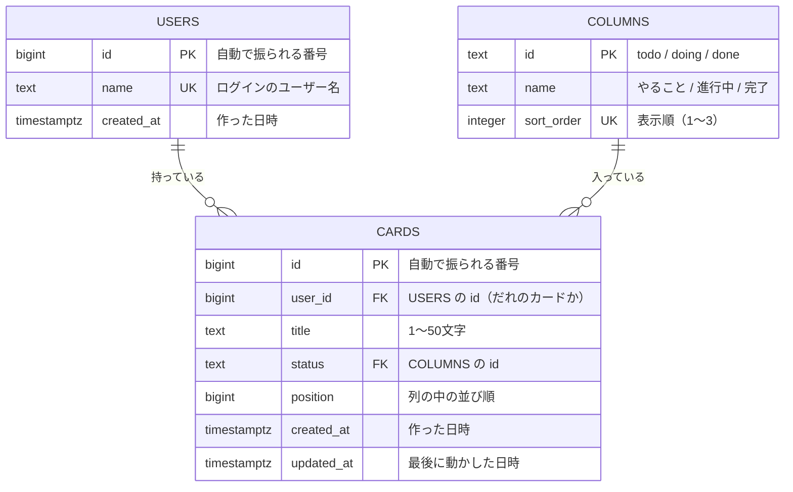
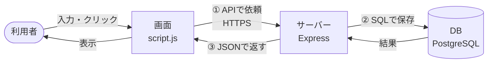
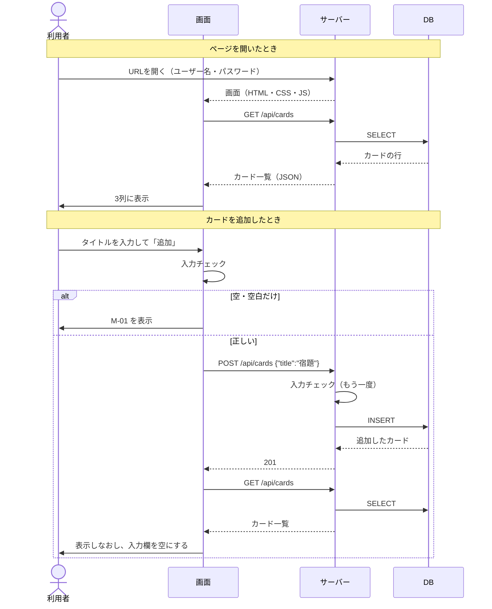

# データ設計

> APIは [API設計](05_api-design.md)、テーブル定義の実物は `db/schema.sql`

## ER図は必要か
ER図は、データベースの「表（テーブル）」と、表どうしのつながりを設計するための図。
今回は本物のDB（PostgreSQL）を使うので、**ER図がそのままテーブルの設計図になる**。表は「ユーザー」「列」「カード」の3つと少ないが、書いておく。

## ER図

- 1人のユーザーは、カードを0枚以上持つ。
- 1枚のカードは、必ず1人のユーザーのもの（`user_id` は `users` にある値しか入らない）。
- 1つの列には、カードが0枚以上入る。
- 1枚のカードは、必ずどれか1つの列に入っている（`status` は `columns` にある値しか入らない）。

### users 表を作る理由
- 講義の課題「タスクとユーザーの関係」をER図で表すため。
- 利用者は今も自分ひとりなので、users 表に入るのは自分の1行だけ。ユーザー登録の画面は作らない（[作らないもの](01_requirements.md)）。
- カードに `user_id` を持たせておくと、あとで利用者を増やしたくなったときに、表を作りなおさずにすむ。
- ★ログインは今のままベーシック認証（パスワードは環境変数）とし、ログインしたユーザー名と `users.name` を結びつける。パスワードをDBに持たせるかは、あとで見直す。

## テーブル定義
定義の実物は `db/schema.sql`。サーバーを起動するたびに実行し、無ければ作る。

**users（ユーザー）※今は自分の1件だけを入れる表**
| 項目 | 型 | 必須 | ルール |
|------|----|------|--------|
| id | bigint | ○ | 主キー。DBが自動で振る |
| name | text | ○ | 重ならない（UNIQUE）。ベーシック認証のユーザー名と同じにする |
| created_at | timestamptz | ○ | 初期値は今の日時 |

**columns（列）※決まった3件だけを入れる表**
| 項目 | 型 | 必須 | ルール |
|------|----|------|--------|
| id | text | ○ | 主キー |
| name | text | ○ | 画面に出す名前 |
| sort_order | integer | ○ | 重ならない（UNIQUE）。小さいほど左 |

| id | name | sort_order |
|----|------|-----------|
| todo | やること | 1 |
| doing | 進行中 | 2 |
| done | 完了 | 3 |

**cards（カード）**
| 項目 | 型 | 必須 | ルール |
|------|----|------|--------|
| id | bigint | ○ | 主キー。DBが自動で振る |
| user_id | bigint | ○ | 外部キー（`users.id`）。ユーザーを消すと、そのカードも消える |
| title | text | ○ | 1〜50文字（DBでもチェックする） |
| status | text | ○ | 外部キー（`columns.id`）。初期値 `todo` |
| position | bigint | ○ | 追加・移動のたびに新しい番号を振る（列の一番下に入る）。並び替え（F-09）では、となりのカードと番号を入れかえる。小さいほど上 |
| created_at | timestamptz | ○ | 初期値は今の日時 |
| updated_at | timestamptz | ○ | 移動したときに今の日時に変える |

インデックス：`(user_id, status, position)`。ユーザーごと・列ごとに並べて取りだすのを速くする。

## データの流れ
データは次の3か所にある。

| 場所 | 役割 |
|------|------|
| 画面（ブラウザ） | 利用者に見せる。DBから読んだ写しを持つだけ |
| サーバー（Express） | 画面からの依頼を受けて、チェックしてからDBを読み書きする |
| DB（PostgreSQL） | **正しいデータはここだけ** |

決まりごと：**操作したら「① サーバーに送る → ② DBに保存する → ③ DBから一覧を読みなおして画面を作りなおす」の順番で必ず処理する。** 画面だけを先に書きかえないことで、画面とDBがずれるのを防ぐ。

**開いたとき・カードを追加したときの流れ**

移動・並び替え・削除も同じ順番（依頼 → 保存 → 読みなおして表示）で処理する。

**操作ごとのデータの変化**
| 操作 | API | SQL | 変わる項目 |
|------|-----|-----|-----------|
| 開く | `GET /api/cards` | SELECT | － |
| 追加 | `POST /api/cards` | INSERT | カードが1枚増える（status は `todo`） |
| 移動 | `PATCH /api/cards/:id` | UPDATE | status・position・updated_at |
| 並び替え | `POST /api/cards/:id/reorder` | UPDATE（2枚をまとめて。トランザクション） | 2枚の position を入れかえる・updated_at |
| 削除 | `DELETE /api/cards/:id` | DELETE | カードが1枚減る |
